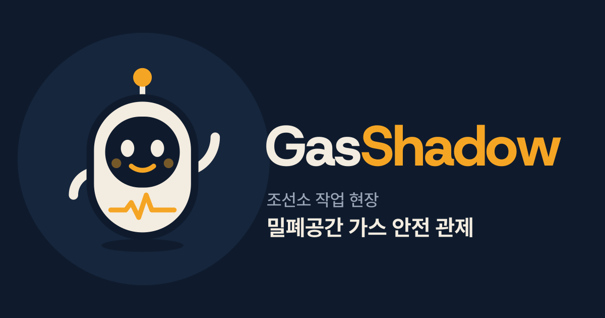
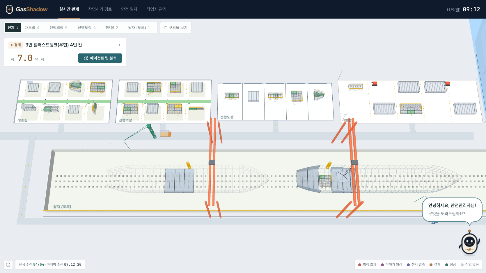
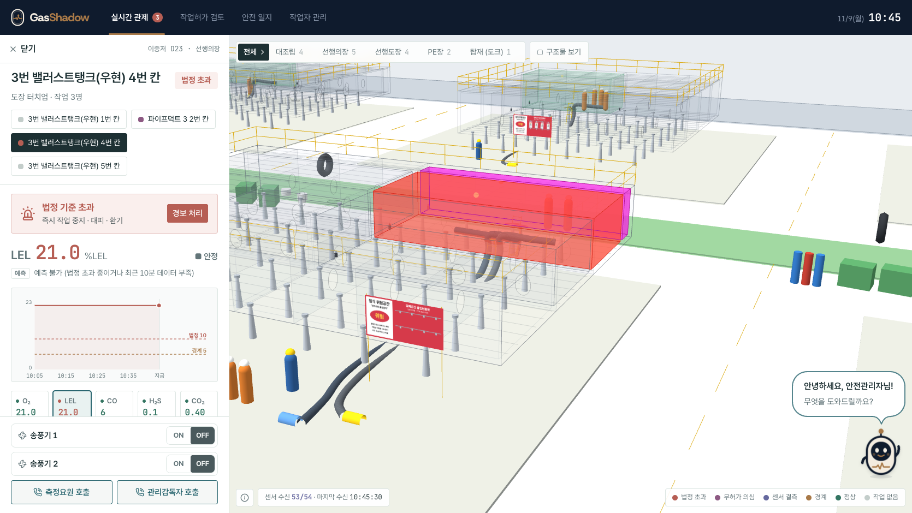
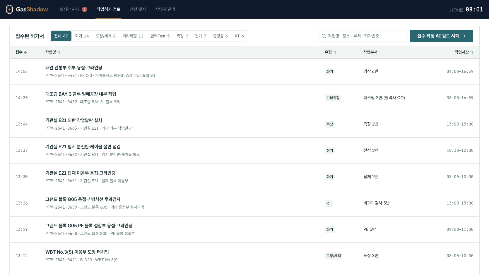
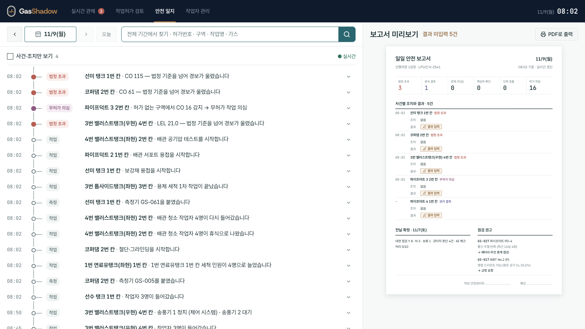
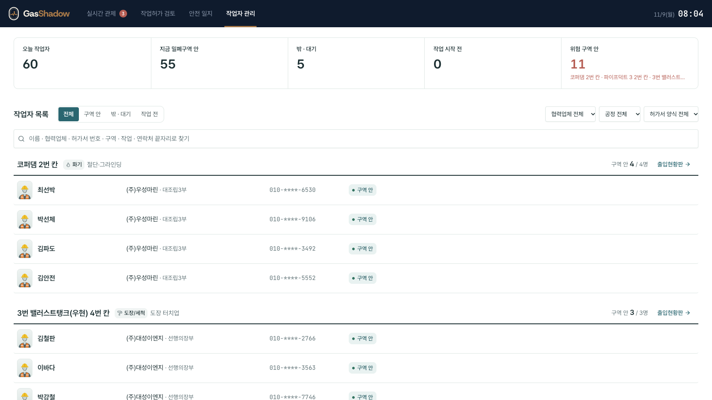

# Gas Shadow

조선소 밀폐구역 가스 위험을 **미리 알리는** 관제 시스템 — 2026 K-조선 해커톤, 팀 선두사공

> 규칙이 판정하고, AI는 미리 알리고 조치 근거를 찾아주고, 사람이 승인한다.



- **바로 써 보기**: <https://gas-shadow-production.up.railway.app/>
- **시연 영상**: [media/GasShadow_demo.mp4](media/GasShadow_demo.mp4)

## 무엇을 하나

상단 탭 4개로 나뉜다.

- **실시간 관제**: 밀폐구역마다 5가스(O₂·LEL·CO·H₂S·CO₂)를 실시간으로 보고, 3D 조선소 위에 칸 단위로 상태를 표시한다. 최근 40분 추세로 앞으로 60분 안에 어떤 가스가 언제 기준을 넘을지 미리 알리고, 경보가 뜨면 안전 에이전트 팀이 조치 근거를 정리해 관리자가 승인한다
- **작업허가 검토**: 접수된 위험작업허가서를 AI가 사전 검토해 기재 누락·위험 조합을 짚고, 관리자가 보완 요청·반영·문제 없음으로 처리한다
- **안전 일지**: 사건·조치 타임라인과 일일 안전 보고서 (PDF 출력)
- **작업자 관리**: 오늘 작업자, 밀폐구역 안·밖 인원, 위험 구역 안 인원

### 실시간 관제



- 조선소 3D 위에 공정(대조립 · 선행의장 · 선행도장 · PE장 · 탑재)별 블록과 밀폐구역 칸을 상태 색(법정 초과 · 무허가 의심 · 센서 결측 · 경계 · 정상)으로 보여 준다
- 왼쪽에는 지금 확인할 곳(법정 초과 → 센서 결측 → 경계)이 뜨고, 바로 경보 처리나 에이전트 팀 분석을 할 수 있다
- 오른쪽 아래 안전 에이전트 캐릭터를 누르면 대화창이 열리고 추천 질문으로 현장 상황을 물어볼 수 있다



- 칸을 고르면 3D가 그 칸으로 다가가고, 왼쪽에 **구역 상세**가 열린다: 지금 값, 최근 40분 그래프(경계 · 법정 기준선), 5가스, 송풍기 ON/OFF, 측정요원 · 관리감독자 호출
- 작업 칸 옆의 허가 없는 칸에서 작업 흔적 가스가 잡히면 **무허가 작업 의심**(보라)으로 표시한다

### 나머지 탭

| 작업허가 검토 | 안전 일지 | 작업자 관리 |
|---|---|---|
|  |  |  |

## 폴더 구조

```
.
├── src/
│   ├── dashboard/       관제 대시보드 (React + Vite + Three.js) ← 화면 시연
│   └── server/          메인 서버 · AI 서버 · 센서 재생기 (FastAPI)
├── 가스예측모델/         5가스 실시간 위험예측 모델 (scikit-learn) · 평가 결과
├── 합성데이터_간소화/    모델 학습·검증용 합성 데이터와 생성기
├── scripts/             화면용 데이터(site.json · episodes.json) 생성
├── docs/                시스템 구조도 · 모델 요약 · 스크린샷
└── media/               시연 영상
```

## 실행

대시보드 (Node.js 20.19+):

```bash
cd src/dashboard
npm install
npm run dev        # http://localhost:8732
```

서버 없이도 화면은 내장 시뮬레이션으로 동작한다. 서버 실행법과 AI를 쓰는 곳은 [src/server/README.md](src/server/README.md), 모델은 [가스예측모델/README.md](가스예측모델/README.md), 합성 데이터는 [합성데이터_간소화/README.md](합성데이터_간소화/README.md)에 있다.

## 주의

- 화면·서버·모델에 쓰인 **모든 데이터는 합성(SYNTHETIC)** 이다. 작업자 이름·회사·연락처, 허가서, 사고 판례는 시연용 가상 값이다.
- 모델은 합성 데이터로만 학습·평가했으며 현장 성능을 입증하지 않는다.
- 멘토링·현장 견학으로 받은 조선소 내부 자료(세칙·양식 원문, 현장 사진 등)는 이 저장소에 포함하지 않았다. 화면의 '사내 세칙·양식' 근거 문구는 일반적인 내용으로 바꾼 예시다.
